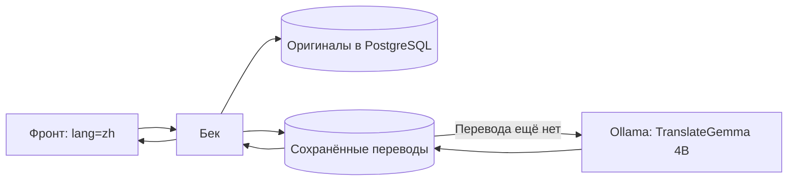

# Бесплатный локальный перевод RU / EN / ZH

В проект подключён Ollama с моделью **TranslateGemma 4B**. Модель работает на твоём ПК, запросы к платным API не нужны. После загрузки модели перевод работает без интернета. Облачные функции Ollama отключены через `OLLAMA_NO_CLOUD=1`. [Модель и языки](https://ollama.com/library/translategemma:4b), [локальный режим Ollama](https://docs.ollama.com/faq).

Для 16 ГБ RAM выбран небольшой вариант модели: файл весов около 3,3 ГБ. Контейнеру выделен предел 6 ГБ, одновременно выполняется один перевод. Оставь примерно 15–20 ГБ свободного места для Docker, модели и обновлений. GTX 1050 Ti может потребовать частичной работы на CPU; в текущем Docker WSL видеокарта не обнаружилась, поэтому проверенный запуск использует CPU.

Docker Desktop бесплатен для личного использования; модель распространяется по условиям Gemma. Это бесплатный локальный запуск, а не оплачиваемый облачный сервис. [Условия Docker Desktop](https://docs.docker.com/subscription-billing/desktop-license/), [условия Gemma](https://ai.google.dev/gemma/terms).

## Как это работает

1. Фронт берёт выбранный язык из переключателя и добавляет `lang=ru`, `lang=en` или `lang=zh` ко всем своим API-запросам, включая авторизацию.
2. Бек получает обычные данные из PostgreSQL. Для текстовых полей он сначала проверяет готовый перевод в таблице `content_translations`.
3. Если перевода нет, бек отправляет текст локальному Ollama, получает перевод и сохраняет его в отдельной таблице.
4. Следующие запросы используют готовый результат. Изменение оригинального текста создаёт новый ключ кеша, поэтому старый перевод не подставляется в обновлённую запись.
5. Запрос с `original=true` возвращает исходные данные. Формы редактирования работ, профиля, событий и справочников используют этот режим.



Переводятся названия и описания работ и событий, биографии, профессии, жанры, стили, виды искусства, теги, названия мест, подписи тарифов и текстовые сообщения HTTP API. Уведомления в списке используют существующие шаблоны RU/EN/ZH, а название работы переводится отдельно. Имя, фамилия, отчество как поля профиля, идентификаторы, пароли, токены, email, ссылки, цены, валюты, даты и статусы сохраняют исходные значения. В JSON-характеристиках сохраняются ключи и технические значения; переводятся известные текстовые поля, например материал и техника.

`zh` означает упрощённый китайский; модели передаётся код `zh-Hans`. Русский и английский названия мест из БД имеют приоритет перед машинным переводом. Поиск пока ищет в исходном тексте и имеющихся названиях RU/EN; переведённые описания не становятся отдельным поисковым индексом.

## Запуск переводчика на Windows

Открой PowerShell в корне проекта. Docker Desktop должен быть запущен, выбран режим Linux containers / WSL 2.

Если команда `docker` не найдена, в этом окне PowerShell добавь каталог установленного Docker:

```powershell
$env:Path += ';C:\Program Files\Docker\Docker\resources\bin'
```

Запусти контейнер и загрузи модель:

```powershell
docker compose -f deploy/translation.compose.yml up -d
docker compose -f deploy/translation.compose.yml exec -T translator ollama pull translategemma:4b
docker compose -f deploy/translation.compose.yml exec -T translator ollama list
```

Загрузка нужна один раз. Модель хранится в Docker volume и сохраняется при пересоздании контейнера. На этом ПК образ и модель уже загружены, контейнер запущен.

В `server/dev.env` для разработки и `server/.production.env` для домашнего production должны быть строки:

```dotenv
TRANSLATION_ENABLED=true
TRANSLATION_URL=http://127.0.0.1:11434
TRANSLATION_MODEL=translategemma:4b
```

В локальные файлы эти настройки уже внесены. В отслеживаемых примерах стоит `false`, чтобы новая установка могла сначала загрузить модель и подготовить БД.

Собери бек и создай только таблицу переводов:

```powershell
Set-Location server
npm run build
npm run translations:migrate
```

Для production установи окружение **до** запуска команд, чтобы использовался правильный файл БД:

```powershell
$env:NODE_ENV = 'production'
npm run translations:migrate
npm run translations:warm
```

Для разработки используй `$env:NODE_ENV = 'development'`.

Команды не изменяют оригиналы, пользователей, оплаты и другие таблицы. `translations:migrate` создаёт таблицу переводов, если её ещё нет. `translations:warm` читает работы, события, биографии, справочники, страны и используемые в проекте города и заранее сохраняет переводы. Повторный запуск использует уже заполненный кеш.

Лучше выполнить прогрев **до открытия сайта посетителям**:

```powershell
npm run translations:warm
```

Можно подготовить один язык:

```powershell
npm run translations:warm -- en
npm run translations:warm -- zh
```

На CPU эта команда может работать долго: время зависит от объёма текста. Число `unavailable` в конце показывает поля, для которых перевод не удалось получить. Корректные переводы, совпавшие с оригиналом, например некоторые имена собственные, ошибкой не считаются. При ошибке подключения сначала восстанови Ollama и повтори команду. Переводы, уже сохранённые в БД, остаются.

После изменения env перезапусти бек. Для разработки из каталога `server`:

```powershell
npm run start:dev
```

Во втором окне PowerShell из корня проекта запусти фронт:

```powershell
Set-Location frontend
npm run dev
```

Открой `http://localhost:5173` и выбери язык в переключателе. Отдельного адреса переводчика на фронте нет.

Для домашнего production используй существующую инструкцию [deploy/README.md](deploy/README.md) и `deploy/windows/start.ps1`.

## Если хочешь попробовать видеокарту

Docker Desktop на Windows передаёт GPU через WSL 2. Нужны подходящий драйвер NVIDIA и актуальный WSL. [Настройка GPU в Docker Desktop](https://docs.docker.com/desktop/features/gpu/), [совместимость Ollama с NVIDIA](https://docs.ollama.com/gpu).

Из корня проекта:

```powershell
docker compose -f deploy/translation.compose.yml -f deploy/translation.gpu.yml up -d
docker compose -f deploy/translation.compose.yml exec -T translator ollama ps
```

`ollama ps` показывает распределение CPU/GPU, когда модель загружена. Если возникает `WSL environment detected but no adapters were found`, верни рабочий режим CPU:

```powershell
docker compose -f deploy/translation.compose.yml up -d
```

Модель и кеш при смене режима сохраняются. Для GTX 1050 Ti полная загрузка модели в видеопамять не гарантирована.

## Если весь сайт запускается через Docker

В `deploy/docker-compose.yml` уже добавлен сервис `translator`. Сервер обращается к нему по внутреннему адресу `http://translator:11434`; localhost внутри контейнера для этого не подходит.

Останови отдельный переводчик, чтобы освободить его локальный порт:

```powershell
docker compose -f deploy/translation.compose.yml stop
docker compose -f deploy/docker-compose.yml up -d --build
docker compose -f deploy/docker-compose.yml exec -T translator ollama pull translategemma:4b
docker compose -f deploy/docker-compose.yml exec -T server npm run translations:migrate
docker compose -f deploy/docker-compose.yml exec -T server npm run translations:warm
```

Этот вариант использует БД основного Docker Compose. Перед запуском перенеси в неё данные по инструкции развёртывания; локальная Windows-БД и контейнерная БД — разные экземпляры. На ПК с уже работающим PostgreSQL проверь конфликт порта 5432 согласно инструкции развёртывания. У отдельного и общего Compose отдельные volumes модели, поэтому общий Compose может загрузить её ещё раз.

## Проверка и обслуживание

Примеры запросов:

```text
http://localhost:5000/events?lang=ru
http://localhost:5000/events?lang=en
http://localhost:5000/events?lang=zh
http://localhost:5000/events/1?lang=zh&original=true
```

В заголовке `Content-Language` указан выбранный язык. `X-Translation-Status` может быть `complete`, `pending` или `partial`.

На этом ПК проверены ответы событий, списка модерированных авторов и стилей для всех трёх языков: после прогрева статус `complete`. События и стили отвечали примерно за 5–20 мс, список авторов — за 0,4–0,6 секунды. Это измерения текущей небольшой БД; время на большом количестве данных будет другим. Имена авторов сохраняются, а `original=true` не отключает проверку доступа.

На чтение выделено до 15 секунд ожидания модели. Если перевод не успел, сервер возвращает оригинал, а работа продолжает заполнять кеш. Фронт повторяет такой GET один раз и при необходимости показывает сообщение, что часть текста ещё в оригинале. Записи и ошибки API ждут только 200 мс; операции изменения данных повторно из-за перевода не отправляются. При недоступном Ollama сохраняется доступ к сайту и уже готовым переводам.

Посмотреть логи и освободить память модели:

```powershell
docker compose -f deploy/translation.compose.yml logs --tail 50 translator
docker compose -f deploy/translation.compose.yml exec -T translator ollama stop translategemma:4b
```

Контейнер сам выгружает неиспользуемую модель после 10 минут. Следующий новый перевод снова загрузит её в память. Чтобы остановить сервис:

```powershell
docker compose -f deploy/translation.compose.yml stop
```

Для отключения функции установи `TRANSLATION_ENABLED=false` и перезапусти бек. Кеш входит в обычную резервную копию PostgreSQL. Не используй `down -v`, если хочешь сохранить скачанные веса. Порт 11434 доступен только с этого ПК; пробрасывать его на роутере не нужно.

## Качество и ручные исправления

В запрос модели добавлен небольшой словарь художественных терминов, например натюрморт, пейзаж и масло на холсте. Автоматически определяется исходный язык RU/EN/ZH; длинный текст разбивается на части. Поля длиннее 20 000 символов остаются в оригинале, чтобы одна запись не заняла всю очередь. Смешанные языки, имена внутри биографии, неоднозначные формулировки и тексты со сложным контекстом стоит проверять человеком: модель 4B не гарантирует безошибочный перевод.

Если текстовое поле хранит JSON с готовыми переводами, они имеют приоритет:

```json
{"ru":"Натюрморт","en":"Still life","zh":"静物画"}
```

Необязательно менять оригинал на JSON. Можно исправить только сохранённый перевод через БД, предварительно проверив нужную строку:

```sql
SELECT key, source_text, target_language, translated_text
FROM content_translations
WHERE source_text = 'Натюрморт' AND target_language = 'en';

UPDATE content_translations
SET translated_text = 'Still life'
WHERE key = 'ключ_проверенной_строки';
```

При изменении исходного текста будет создан новый ключ; ручную правку для новой версии нужно проверить снова. После смены весов под тем же тегом модели удали из кеша только строки этой модели и снова выполни прогрев. Админка ручных переводов и отдельный перевод поискового ввода в эту задачу не добавлены.
